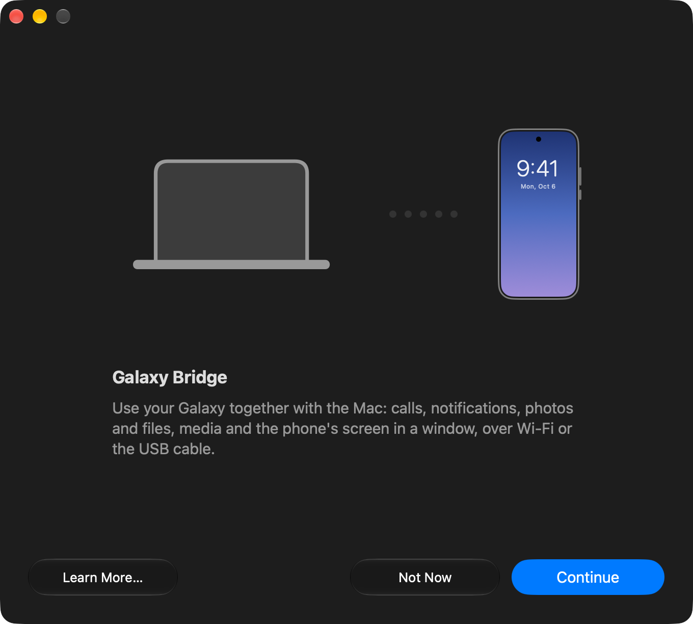

# Galaxy Bridge

Use a Samsung Galaxy (or any Android phone) together with your Mac, over Wi-Fi or a USB cable.

<p align="center">
  <a href="https://github.com/julianamarques/galaxy-bridge/releases/latest"></a>
  
  
  
  
  
  <a href="LICENSE"></a>
</p>

<p align="center">
  
</p>

Galaxy Bridge lives in the menu bar and brings the phone to the Mac:

- **Calls** — place calls from the menu or from any phone number on the Mac (`tel:` links), and answer or decline incoming calls in a panel with the caller's name and photo. The menu finds contacts as you type and lists the recent calls.
- **Notifications** — the phone's notifications show on the Mac, with replies, buttons and pictures.
- **Photos and files** — every photo and video on the phone, its folders, a photo taken with the phone that arrives copied on the Mac, and files both ways.
- **Screen mirroring** — the phone's screen in a window, with sound, mouse, keyboard and copy and paste.
- **Status** — battery, signal, storage, Do Not Disturb, what is playing (with controls) and the battery of the earbuds connected to the phone.
- **And more** — ringing the phone to find it, battery alerts, links and copied text between the two, and a guided introduction on both apps.

There are two ways to connect:

- **The Galaxy Bridge app on the phone** (recommended). Pair once with a QR code; after that the phone reconnects on its own, over Wi-Fi or the USB cable, also after a restart, without Developer options. Everything above works with it.
- **adb**, with nothing installed on the phone: Wireless debugging or USB debugging. It covers the battery, placing calls and screen mirroring; the rest needs the app. A Galaxy already connected to the Mac through adb works here without pairing again.

## Install

1. Download `Galaxy-Bridge.dmg` from the latest version on the [Releases page](https://github.com/julianamarques/galaxy-bridge/releases).
2. Open the file and drag **Galaxy Bridge** to **Applications**.
3. On the phone, install the Galaxy Bridge app for Android (coming to Google Play) and scan the QR code the Mac shows. Without it, the Mac app connects over adb.

The Android app reads calls, contacts, notifications, photos and files only to send them to the paired Mac; see the [privacy policy](https://github.com/julianamarques/galaxy-bridge/wiki/Privacy-Policy).

The Mac app is only signed locally. On another Mac, macOS blocks the first launch saying it cannot verify the developer: allow it in **System Settings › Privacy & Security › Open Anyway**.

## Requirements

- macOS 14 or later
- A phone on the same Wi-Fi network as the Mac, or connected to it with a USB cable: Android 13 or later for the Galaxy Bridge app, Android 11 or later for adb
- For the Android app: the permissions of the features you use, asked one by one in the app's introduction. The ones with the biggest effect are running without battery restrictions, so Android doesn't cut the connection while the screen is off, and notification access, which carries notifications, the caller's name and media. Screen mirroring control uses an accessibility service; Android may ask to allow restricted settings in the app's info first.
- For adb: Wireless debugging (or USB debugging and a cable) turned on

## Build

### Mac app

The Swift package in `macos/`:

```bash
cd macos
./scripts/build-app.sh          # builds build/Galaxy Bridge.app for this Mac's architecture
./scripts/build-app.sh debug    # debug build
./scripts/make-dmg.sh           # builds build/Galaxy Bridge.dmg
```

Add `--universal` to `build-app.sh` or `make-dmg.sh` to build for Apple Silicon and Intel; releases always do.

To publish a new version on GitHub (requires a logged-in `gh`):

```bash
DRY_RUN=1 ./scripts/release.sh 1.1.0   # shows the notes without changing anything
./scripts/release.sh 1.1.0-beta.1      # pre-release (alpha, beta or rc)
./scripts/release.sh 1.1.0             # stable version
```

It sets the version in `Resources/Info.plist`, commits and pushes it, builds the universal `.dmg` and creates the GitHub release with it.

`swift test` (in `macos/`) runs the tests. The app icon is drawn in SwiftUI by `scripts/make-icon.swift`; run it after changing the drawing to regenerate `Resources/AppIcon.icns`. In debug builds, `GALAXY_PREVIEW_MENU=1` shows the menu in a regular window, `GALAXY_PREVIEW_SETTINGS=1` opens Settings at launch, `GALAXY_PREVIEW_CALL=1` and `GALAXY_PREVIEW_TRANSFER=1` show a fake call and transfer in the activity panel, `GALAXY_START_MIRROR=1` starts mirroring at launch and `GALAXY_PREVIEW_SETUP=1` opens the setup window on its welcome screen, to check the design without clicking the menu bar. `GALAXY_PREVIEW_NAME` replaces the Mac's name in the app, for screenshots.

The build script copies the Swift package resources (PhoneNumberKit's phone number data) into the app and downloads `adb` (`scripts/fetch-adb.sh`, platform-tools 37.0.1) and the scrcpy server (`scripts/fetch-scrcpy.sh`, 5.0) and checks their checksums. Keep it the same as other apps on the Mac that bundle `adb`: two different `adb` versions restart each other's server and drop the connection.

### Android app

The Gradle project in `android/`. It needs a JDK 17 or later and the Android SDK (API 37), with the SDK's path in `android/local.properties` (`sdk.dir=…`, not committed):

```bash
cd android
./gradlew assembleDebug         # app/build/outputs/apk/debug/app-debug.apk
./gradlew testDebugUnitTest     # protocol tests, against protocol/fixtures
adb install -r app/build/outputs/apk/debug/app-debug.apk
```

Release builds are shrunk with R8 and signed with the upload key. Its settings live in `android/keystore.properties`, which is not committed:

```properties
storeFile=/path/to/upload.jks
storePassword=…
keyAlias=upload
keyPassword=…
```

```bash
./gradlew lintRelease           # must report no errors
./gradlew bundleRelease         # app/build/outputs/bundle/release/app-release.aab, for Google Play
```

Without `keystore.properties` the release build is signed with the debug key, which is enough to try it on a phone.

Install it with `adb` while developing. A plain APK opened on the phone is blocked by Play Protect in Brazil because of the permissions the app asks for, so users will get it from a store (see [Distribution](docs/architecture.md#distribution)).

To pair: on the Mac, **Settings › Usar o App no Galaxy…** (or the setup window on first launch) shows a QR code. On the phone, open Galaxy Bridge and scan the code; the app's introduction then asks for the permissions of each feature.

## Languages

Both apps are in English and Brazilian Portuguese, following the system language (other languages get English). The Android app's language can also be picked in **Settings › Apps › Galaxy Bridge › Language**.

- **Mac:** the code keeps the Portuguese text as keys (`String(localized:)`, `Text("…")`), and `macos/Resources/en.lproj` holds the English: `Localizable.strings`, `InfoPlist.strings` (the Local Network prompt) and `ServicesMenu.strings` (the Finder's "Send to Galaxy"). `scripts/check-translations.sh` asks the Swift compiler for every localizable text and lists the ones without an English translation and the translations no text uses anymore; run it after changing any text.
- **Android:** `res/values/strings.xml` is English and `res/values-pt/strings.xml` Portuguese. Texts shown to the user belong there, not in the code.

## Structure

```
macos/                    the Mac app (Swift package)
├── Sources/
│   ├── BridgeProtocol/   messages, framing, TLS identity, pairing, BridgeServer (no UI)
│   ├── GalaxyKit/        adb connection
│   └── GalaxyBridge/     the menu bar app
│       ├── App/          entry point, app delegate, Services menu
│       ├── Mirror/       screen mirroring: scrcpy over adb and the Android app's stream, video decoding, audio
│       ├── ViewModels/   AppModel, SetupModel, MirrorController, FileBrowser, GalleryBrowser
│       ├── Services/     activity panel, Notification Center, phone apps and icons, USB accessory link, Dock
│       ├── Views/        menu, activity panel, setup and introduction, mirror, files and photos windows, settings
│       └── Extensions/   default tel: handler, launch at login, links
├── Tests/                BridgeProtocolTests, GalaxyKitTests
├── Resources/            Info.plist, icon, translations, bundled adb and scrcpy server
└── scripts/              build, adb and scrcpy downloads, icon, translation check
android/                  the Android app (Kotlin, Jetpack Compose)
└── app/src/main/java/com/julianamarques/galaxybridge/
    ├── bridge/           BridgeService, TLS connection, USB tunnel, Keystore identity, Mac discovery, calls,
    │                     contacts, notifications, media, gallery, files, accessories
    ├── mirror/           screen capture, encoder, accessibility control, sound
    ├── protocol/         messages and framing
    └── ui/               pairing, introduction and home screens
protocol/                 protocol reference and JSON fixtures shared by both test suites
docs/                     architecture, plans and test results
spikes/                   throwaway experiments: Phase 0 and the Bluetooth hands-free test
```

## How it works

- **Connection (Android app)** — the Mac listens on port 52800 and advertises `_galaxybridge._tcp` over Bonjour; the phone connects to it with TLS 1.3, both sides pinning the other's certificate from the QR code pairing. A foreground service on the phone reconnects when Wi-Fi comes back, after a restart and when the Mac app reopens. The Mac pings every 2 minutes to tell a phone that has gone from a quiet one. Details in [protocol/protocol.md](protocol/protocol.md) and [docs/architecture.md](docs/architecture.md).
- **Connection (adb)** — pairing with a QR code or a six-digit code, `adb connect` to the phone's `_adb-tls-connect._tcp` service, switching to the USB cable when it is plugged in, and reconnecting every 30 seconds while the phone is away.
- **USB cable (Android app)** — with the cable plugged in, the Mac asks the phone to switch to Android's USB accessory mode (no developer options needed) and every connection, from calls to mirroring, goes through the cable, also without Wi-Fi. The first time, Android asks to open Galaxy Bridge for the accessory: choose **Always**. Unplugging the cable falls back to Wi-Fi. While in accessory mode the cable doesn't do file transfer (MTP) for other apps.
- **Guided introduction** — after pairing, both apps walk through the features page by page, in the style of Apple's Continuity setup: on the Mac, what each feature does and where it lives; on the phone, each feature with the permission it needs (**Permitir** or **Agora não**). **Settings › Sobre › Rever Introdução** on the Mac and **Rever introdução** in the phone app's About card show it again.
- **Dock** — the app lives in the menu bar, and shows in the Dock and in ⌘Tab only while one of its windows (mirroring, photos, files, Settings) is open.
- **Battery** — the Android app sends it when it changes; with adb, `dumpsys battery` every minute.
- **Calls** — the Android app dials with `TelecomManager.placeCall()`; with adb, `am start -a android.intent.action.CALL`. Numbers are formatted as you type and dialed in international format (`+55 86 99999-0001`) with [PhoneNumberKit](https://github.com/PhoneNumberKit/PhoneNumberKit), using the country of the network the Galaxy is on (so it follows you when traveling), then the SIM's country, then the Mac's region. The audio stays on the phone (or on the earbuds connected to it). **Settings › Ligações** makes the app the default handler for `tel:` links; macOS asks for confirmation.
- **Clipboard (Android app)** — "Enviar Texto Copiado para o …" in the menu copies the Mac's text to the phone; sharing text to "Enviar para o Mac" on the phone copies it to the Mac. Outside screen mirroring, nothing is synced in the background.
- **Files (Android app)** — "Enviar para o Mac" in Android's share sheet saves photos and files to the Mac's Downloads; "Enviar para o Galaxy" in the Finder's context menu, or "Enviar Arquivo para o …" in the menu, saves them to `Download/Galaxy Bridge` on the phone. Each transfer has its own encrypted connection, and a panel in the top-right corner shows the progress. If the Finder doesn't list the service, turn it on in **System Settings › Keyboard › Keyboard Shortcuts › Services**.
- **Notifications (Android app)** — the phone's notifications show in the Mac's Notification Center under the sending app's name, with their buttons, including **Reply** with a text field. Pictures in them (a photo sent on WhatsApp, a screenshot, a big picture) come along and show in the notification on the Mac. Dismissing one on either side dismisses it on the other. Ongoing, silent and call notifications stay on the phone, and **Settings › Notificações** turns off the apps you don't want on the Mac.
- **Battery alerts** — a notification when the Galaxy drops to 20% and 10%, and when it reaches 100% while charging. **Settings › Geral** turns them off.
- **Find my phone (Android app)** — "Tocar o …" in the menu rings the phone for a minute at full volume, also in silent mode, until it is stopped on either side.
- **Recent calls (Android app)** — with the field empty, the menu lists the last four calls from the phone's call history; clicking one calls back. The phone sends the list again whenever its call history changes.
- **Photos and videos (Android app)** — **Fotos e Vídeos do …** in the menu opens a window with every photo and video on the phone, by month, with its albums in a sidebar. Select several (⌘-click) and download them to Downloads, or double-click one.
- **Take a photo (Android app)** — **Tirar Foto com o …** opens the phone's camera (also on the lock screen); the photo arrives on the Mac copied, ready to paste with ⌘V, and saved in Downloads.
- **Contacts (Android app)** — typing a name in the menu searches the phone's contacts as you type (`contacts.search`); the contacts stay on the phone and the Mac only keeps the latest results and the photos it showed.
- **Call back** — the "Ligação perdida" notification has a **Ligar de Volta** button.
- **Links (Android app)** — sharing a link to "Enviar para o Mac" opens it in the Mac's browser; on the Mac, **Services › Abrir no Galaxy** (on a link or a selected address) sends it to the phone, where a notification opens it with a tap. Android doesn't let an app open a page from the background, hence the tap.
- **Media (Android app)** — what is playing on the phone (Spotify, YouTube Music, podcasts…) shows in the menu with the cover, the title and Previous, Play/Pause and Next. It reads the phone's media sessions through the notification access the app already has.
- **Accessories (Android app)** — the battery of earbuds, headphones and other Bluetooth accessories connected to the phone (Galaxy Buds included) shows in the menu, under the phone's name. The phone reads it from Android's Bluetooth stack, so it needs the **Nearby devices** permission (the **Acessórios** tile); accessories that don't report their battery to Android, such as a Galaxy Watch, don't show.
- **Phone status (Android app)** — under the phone's name, the menu shows the carrier, the mobile signal and network (4G, 5G), the Wi-Fi signal, the free storage and a **Não Perturbe** button that turns the phone's Do Not Disturb on and off.
- **File browser (Android app)** — **Arquivos do …** in the menu opens a window with the phone's folders. Double-clicking a file downloads it to Downloads; dragging files from the Mac into the window sends them to the folder that is open. The phone needs the **All files** access (the **Navegar** tile in the app).
- **Screen mirroring** — **Espelhar a Tela do …** in the menu opens a window with the phone's screen, controlled with the mouse, trackpad and keyboard. With the Android app connected it needs no developer options: the phone shows a notification, Android asks to confirm (every time, as for any screen recording), and the phone records its screen with `MediaProjection`, encodes it in H.264 and sends it over its own encrypted connection; taps, scrolling and typing go through the app's accessibility service (**Controle pelo Mac**, turned on once). The phone's sound plays on the Mac (Android asks for the microphone permission once; it still plays on the phone too), and apps that protect their screen (banks, some video apps) show black. Without the Android app it goes through adb: the Mac sends the [scrcpy](https://github.com/Genymobile/scrcpy) server (version 5.0) to the phone over adb, which needs the USB cable or Wireless debugging, and also plays the phone's sound. Dropping files on the window sends them to the phone. While the window is open, text copied on the Mac can be pasted on the phone, and ⌘C or ⌘X in a text field of the phone copies its selection to the Mac. **Settings › Espelhamento** sets the quality, the sound, turning the phone's screen off and keeping the window on top.
- **Incoming calls (Android app)** — the phone follows the call state and reads the caller's name and number from the dialer's notification. On the Mac a panel in the top-right corner shows the caller with Answer and Decline, then the call's duration with End; a call nobody answered, including one taken by One UI's direct voicemail, leaves a "Ligação perdida" notification, and a call declined on the phone doesn't (the phone checks its call history).

## Contributing

See [CONTRIBUTING.md](CONTRIBUTING.md) for how to propose changes, [SECURITY.md](SECURITY.md) to report a vulnerability privately and [CODE_OF_CONDUCT.md](CODE_OF_CONDUCT.md) for the code of conduct.

## License

Apache 2.0. See [LICENSE](LICENSE) and [NOTICE](NOTICE).
